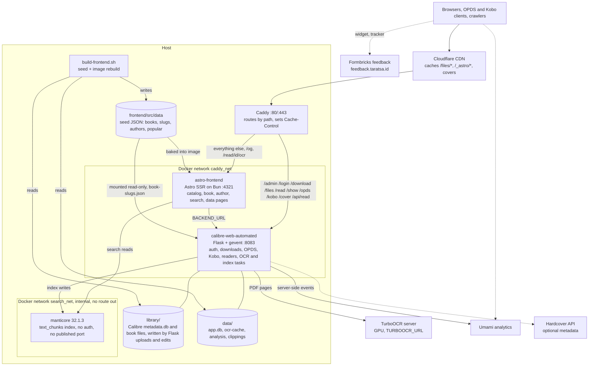
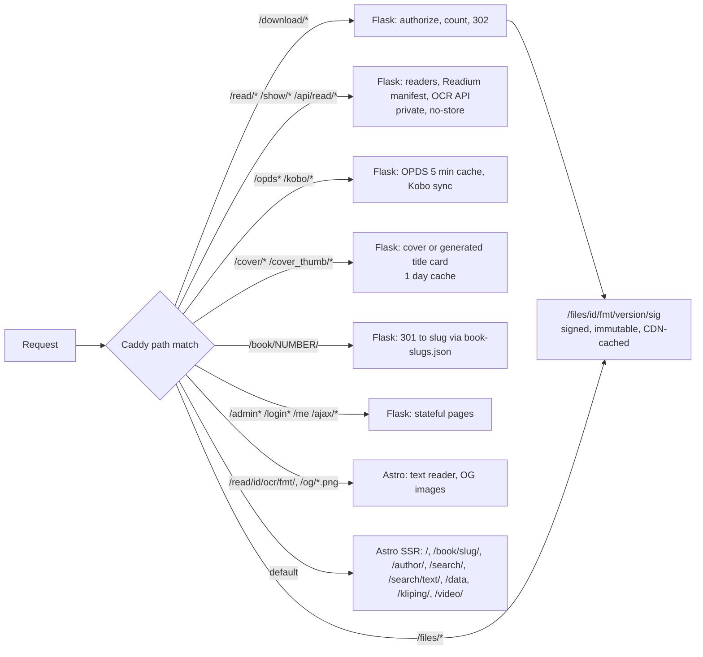
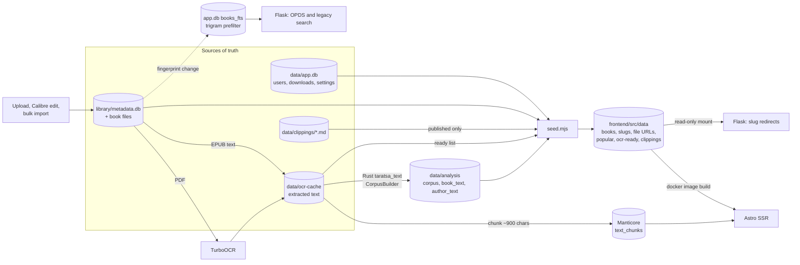

# Calibre-Web

Calibre-Web is a web app that offers a clean and intuitive interface for browsing, reading, and downloading eBooks using a valid [Calibre](https://calibre-ebook.com) database.

[](https://github.com/janeczku/calibre-web/blob/master/LICENSE)

[](https://github.com/janeczku/calibre-web/releases)
[](https://pypi.org/project/calibreweb/)
[](https://pypi.org/project/calibreweb/)
[](https://discord.gg/h2VsJ2NEfB)

<details>
<summary><strong>Table of Contents</strong> (click to expand)</summary>

1. [About](#calibre-web)
2. [Features](#features)
3. [Installation](#installation)
   - [Installation via pip (recommended)](#installation-via-pip-recommended)
   - [Quick start](#quick-start)
   - [Requirements](#requirements)
4. [Architecture](#architecture)
5. [Docker Images](#docker-images)
6. [Troubleshooting](#troubleshooting)
7. [Contributor Recognition](#contributor-recognition)
8. [Contact](#contact)
9. [Contributing to Calibre-Web](#contributing-to-calibre-web)

</details>

*This software is a fork of [library](https://github.com/mutschler/calibreserver) and licensed under the GPL v3 License.*


## Features

- Modern and responsive Bootstrap 3 HTML5 interface
- Full graphical setup
- Comprehensive user management with fine-grained per-user permissions
- Admin interface
- Multilingual user interface supporting 20+ languages ([supported languages](https://github.com/janeczku/calibre-web/wiki/Translation-Status))
- OPDS feed for eBook reader apps
- Advanced search and filtering options
- Custom book collection (shelves) creation
- eBook metadata editing and deletion support
- Metadata download from various sources (extensible via plugins)
- eBook conversion through Calibre binaries
- eBook download restriction to logged-in users
- Public user registration support
- Send eBooks to E-Readers with a single click
- Sync Kobo devices with your Calibre library
- In-browser eBook reading support for multiple formats
- Upload new books in various formats, including audio formats
- Calibre Custom Columns support
- Content hiding based on categories and Custom Column content per user
- Self-update capability
- "Magic Link" login for easy access on eReaders
- LDAP, Google/GitHub OAuth, and proxy authentication support

## Architecture

This fork (branch `taratsa`) runs as the Pustaka deployment at `pustaka.taratsa.id`: a Flask backend (Calibre-Web),
an Astro SSR frontend, and a Manticore full-text index, behind Caddy and Cloudflare. Details per area are in
[AGENTS.md](AGENTS.md); deployment steps are in [DEPLOY.md](DEPLOY.md).

### Infrastructure



| Component | Role | Exposure |
|---|---|---|
| Cloudflare | CDN in front of Caddy. Caches only `/files/*`, `/_astro/*` and covers; never `/download/*`, `/read/*`, `/show/*`, `/api/*`, `/opds*` | public |
| Caddy | Host-level reverse proxy, path routing, cache headers, 500 MB upload limit; serves `/_astro/*` and static assets itself with `file_server`; `old.pustaka.taratsa.id` goes straight to Flask | 80/443 |
| `calibre-web-automated` | Flask app on one gevent loop; owns auth, downloads and counters, OPDS, Kobo, readers, OCR, duplicate scans, admin | `127.0.0.1:8083`, `caddy_net`, `search_net` |
| `astro-frontend` | Public site rendered per request; reads `src/data` baked into the image, queries Manticore for in-text search | `caddy_net`, `search_net` |
| `manticore` | Full-text index over OCR/EPUB text (derived data, rebuildable) | `search_net` only |
| TurboOCR | External GPU OCR server for PDF pages | outbound from Flask |

### Request routing



### Data flow



Notes on how the pieces fit:

- **Catalog changes are batch-published.** New or edited books appear on the Astro site after `./build-frontend.sh`
  (seed from the live `library/metadata.db` and `data/app.db`, rebuild the image, recreate the container, about a
  minute). Flask serves new books immediately.
- **Downloads are counted once, served by the CDN.** `/download` authorizes, counts (anonymous = user 0) and 302s to a
  signed, versioned `/files/...` URL that Cloudflare caches for a year; `/files` never counts.
- **Search has three layers.** `/search/` is an in-process MiniSearch index over `books.json` (Astro); `/search/text/`
  queries Manticore (passages inside the books); OPDS and the legacy UI use `cps/db.py` with an FTS5 prefilter.
- **Text analysis runs off the web loop.** The corpus rebuild (Rust, GIL released) and the full-text reindex are
  background tasks in Flask's worker; do not restart the Flask container while they or OCR run.
- **Manticore has no authentication.** It is reachable only on the internal `search_net`; never publish port 9308.

## Installation

### Installation via pip (recommended)

1. **Create a virtual environment**: It’s essential to isolate your Calibre-Web installation to avoid dependency conflicts. You can create a virtual environment by running:
   ```
   python3 -m venv calibre-web-env
   ```
2. **Activate the virtual environment**:
   ```
   source calibre-web-env/bin/activate
   ```
3. **Install Calibre-Web**: Use pip to install the application:
   ```
   pip install calibreweb
   ```
4. **Install optional features**: For additional functionality, you may need to install optional features. Refer to [this page](https://github.com/janeczku/calibre-web/wiki/Dependencies-in-Calibre-Web-Linux-and-Windows) for details on what can be installed.
5. **Start Calibre-Web**: After installation, you can start the application with:
   ```
   cps
   ```

*Note: Users of Raspberry Pi OS may encounter installation issues. If you do, try upgrading pip and/or installing cargo as follows:*
   ```
   ./venv/bin/python3 -m pip install --upgrade pip
   sudo apt install cargo
   ```

### Important Links
- For additional installation examples, check the following:
   - [Manual installation](https://github.com/janeczku/calibre-web/wiki/Manual-installation)
   - [Linux Mint installation](https://github.com/janeczku/calibre-web/wiki/How-To:-Install-Calibre-Web-in-Linux-Mint-19-or-20)
   - [Cloud Provider setup](https://github.com/janeczku/calibre-web/wiki/How-To:-Install-Calibre-Web-on-a-Cloud-Provider)

## Quick Start

1. **Access Calibre-Web**: Open your browser and navigate to:
   ```
   http://localhost:8083
   ```
   or for the OPDS catalog:
   ```
   http://localhost:8083/opds
   ```
2. **Log in**: Use the default admin credentials:
   - **Username:** admin
   - **Password:** admin123
3. **Database Setup**: If you do not have a Calibre database, download a sample from:
   ```
   https://github.com/janeczku/calibre-web/raw/master/library/metadata.db
   ```
   Move it out of the Calibre-Web folder to avoid overwriting during updates.
4. **Configure Calibre Database**: In the admin interface, set the `Location of Calibre database` to the path of the folder containing your Calibre library (where `metadata.db` is located) and click "Save".
5. **Google Drive Integration**: For hosting your Calibre library on Google Drive, refer to the [Google Drive integration guide](https://github.com/janeczku/calibre-web/wiki/G-Drive-Setup#using-google-drive-integration).
6. **Admin Configuration**: Configure your instance via the admin page, referring to the [Basic Configuration](https://github.com/janeczku/calibre-web/wiki/Configuration#basic-configuration) and [UI Configuration](https://github.com/janeczku/calibre-web/wiki/Configuration#ui-configuration) guides.

## Requirements

- **Python Version**: Ensure you have Python 3.7 or newer.
- **Imagemagick**: Required for cover extraction from EPUBs. Windows users may also need to install [Ghostscript](https://ghostscript.com/releases/gsdnld.html) for PDF cover extraction.
- **Optional Tools**:
   - **Calibre desktop program**: Recommended for on-the-fly conversion and metadata editing. Set the path to Calibre’s converter tool on the setup page.
   - **Kepubify tool**: Needed for Kobo device support. Download the tool and place the binary in `/opt/kepubify` on Linux or `C:\Program Files\kepubify` on Windows.

## Docker Images

Pre-built Docker images are available:

### **LinuxServer - x64, aarch64**
- **Docker Hub**: [linuxserver/calibre-web](https://hub.docker.com/r/linuxserver/calibre-web)
- **GitHub**: [linuxserver/docker-calibre-web](https://github.com/linuxserver/docker-calibre-web)
- **Optional Calibre layer**: [linuxserver/docker-mods](https://github.com/linuxserver/docker-mods/tree/universal-calibre)

To include the Calibre `ebook-convert` binary (x64 only), add the environment variable:
``` 
DOCKER_MODS=linuxserver/mods:universal-calibre
```
in your Docker run/compose file. Omit this variable for a lightweight image.

- **Paths Configuration**:
   - Set **Path to Calibre Binaries** to `/usr/bin`.
   - Set **Path to Unrar** to `/usr/bin/unrar`.

## Troubleshooting

- **Common Issues**: 
   - If you experience issues starting the application, check the log files located in the `logs` directory for error messages.
   - If eBooks fail to load, verify that the `Location of Calibre database` is correctly set and that the database file is accessible.
   - You need to enable uploads under `Basic settings` for this option to appear

- **Configuration Errors**: Ensure that your Calibre database is compatible and properly formatted. Refer to the Calibre documentation for guidance on maintaining the database.

- **Performance Problems**: 
   - If the application is slow, consider increasing the allocated resources (CPU/RAM) to your server or optimizing the Calibre database by removing duplicates and unnecessary entries.
   - Regularly clear the cache in your web browser to improve loading times.

- **User Management Issues**: If users are unable to log in or register, check the user permission settings in the admin interface. Ensure that registration is enabled and that users are being assigned appropriate roles.

- **Support Resources**: For additional help, consider visiting the [FAQ section](https://github.com/janeczku/calibre-web/wiki/FAQ) of the wiki or posting your questions in the [Discord community](https://discord.gg/h2VsJ2NEfB).

## Contributor Recognition

We would like to thank all the [contributors](https://github.com/janeczku/calibre-web/graphs/contributors) and maintainers of Calibre-Web for their valuable input and dedication to the project. Your contributions are greatly appreciated.

## Contact

Join us on [Discord](https://discord.gg/h2VsJ2NEfB)

For more information, How To's, and FAQs, please visit the [Wiki](https://github.com/janeczku/calibre-web/wiki)

## Contributing to Calibre-Web

To contribute, please check our [Contributing Guidelines](https://github.com/janeczku/calibre-web/blob/master/CONTRIBUTING.md). We welcome issues, feature requests, and pull requests from the community.

### Reporting Bugs

If you encounter bugs or issues, please report them in the [issues section](https://github.com/janeczku/calibre-web/issues) of the repository. Be sure to include detailed information about your setup and the problem encountered.

### Feature Requests

We welcome suggestions for new features. Please create a new issue in the repository to discuss your ideas.

## Additional Resources

- **Documentation**: Comprehensive documentation is available on the [Calibre-Web wiki](https://github.com/janeczku/calibre-web/wiki).
- **Community Contributions**: Explore the [community contributions](https://github.com/janeczku/calibre-web/pulls) to see ongoing work and how you can get involved.

---

Thank you for using Calibre-Web! We hope you enjoy managing your eBook library with our tool.
